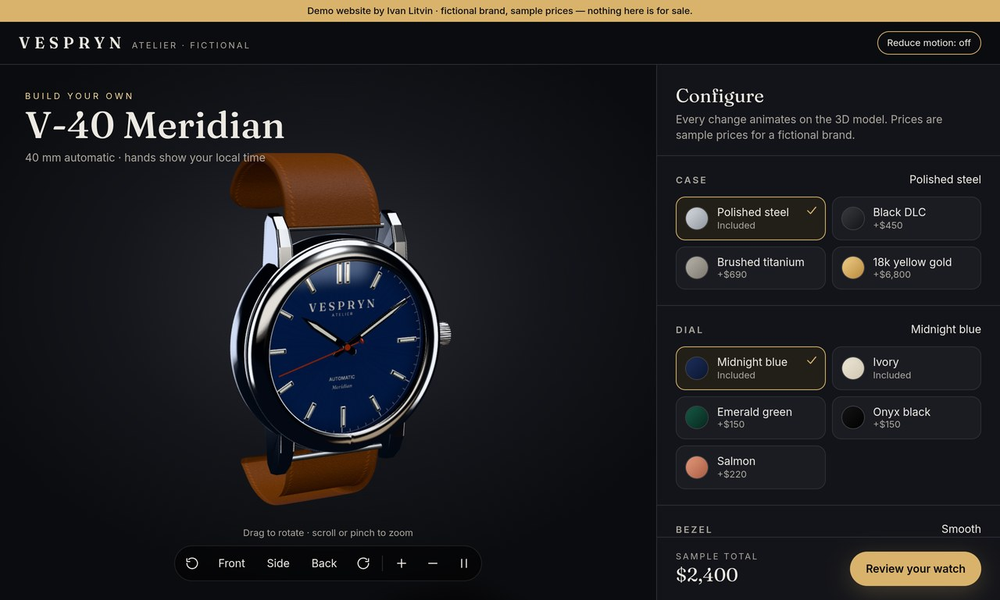
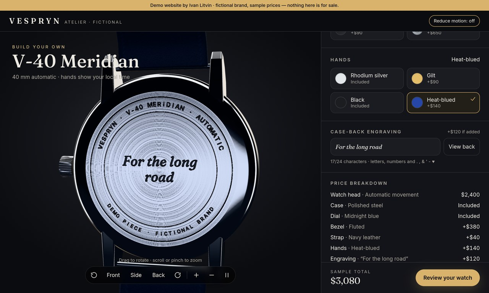

# Vespryn V-40 Meridian: 3D watch configurator (demo)

Portfolio demo by Ivan Litvin. **Fictional brand, sample prices.** Vespryn is not a real watchmaker. Nothing is for sale, and the reserve form sends nothing.

**Live demo:** https://watch-configurator-demo.pages.dev




## What it is
- A procedural three.js watch (no model files and no CDN). It uses PBR metals, glass, leather, rubber and bracelet links, and the hands show your local time.
- Options: case, dial, bezel, strap, hands, plus a case-back engraving that flies the camera to the back. Camera presets are Front, Side and Back.
- A live itemised sample price, a "Review your watch" summary, a shareable URL (`?case=gold&dial=emerald...`) and a demo reserve form (no network).
- WebGL fallback (2D preview), reduced-motion support, a mobile bottom sheet and keyboard access.

## Tech stack
Vite 8 · React 19 · TypeScript 6 · three.js via @react-three/fiber and drei · Tailwind CSS 4 · self-hosted Fraunces and Inter fonts.
The shell is prerendered to static HTML at build time, and the 3D scene is hydrated and lazy-loaded.

## Prices and options: ONE file
`src/config.ts` holds the base price, every option's price, swatches, labels, defaults, the engraving price and length, and the currency.

## Commands
```
npm ci
npm run dev        # local dev
npm run build      # typecheck + build + prerender shell -> dist/
npm run preview    # serve dist on :8797
npm run test:e2e | test:a11y | test:lighthouse              # needs preview running
node tests/shots.mjs / tests/video.mjs                      # portfolio images / video frames
```

## Deploy (Cloudflare Pages)
```bash
npm ci && npm run build
npx wrangler pages deploy dist --project-name watch-configurator-demo
```
If you connect the GitHub repo in the Cloudflare Pages dashboard instead, use build command `npm run build`, output directory `dist`, and set `NODE_VERSION=22`.
URL: https://watch-configurator-demo.pages.dev. The `_headers` file sets the CSP and asset caching. To use another domain, build with `SITE_URL=https://your.domain npm run build`.

## Tests
The test scripts use Playwright, axe-core and Lighthouse from local paths on the original build machine. Adjust the imports at the top of `tests/*.mjs` if you run them elsewhere.

## Notes
- On software WebGL (SwiftShader/llvmpipe) the app switches to an "economy" render loop (on-demand frames, DPR 1). Add `#hq` to the URL to force full quality, or `#nowebgl` to see the fallback.
- The 3D chunk is lazy-loaded after first paint, with a poster image in its place until then.

## License
[MIT](LICENSE) © 2026 Ivan Litvin
